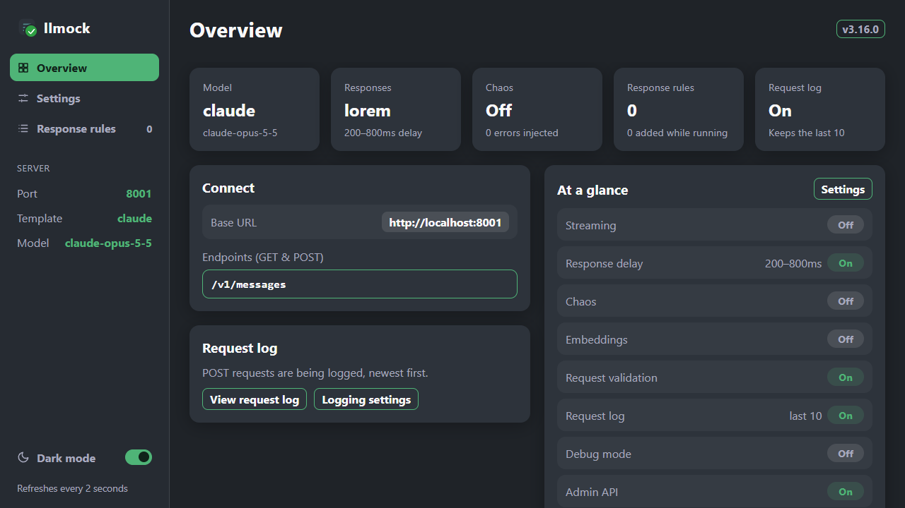
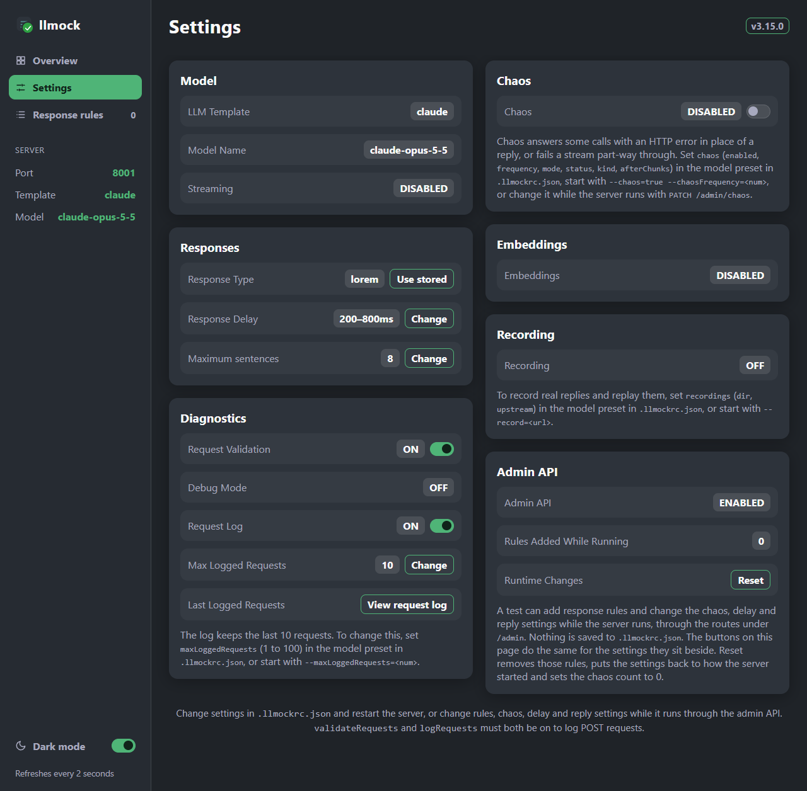

# Dashboard and logging

## Dashboard

Once running, open `http://localhost:8001` for the live dashboard. A health check is at `http://localhost:8001/ping`.





- **Settings** shows the configuration in use. While the [admin API](/reference/admin-api#admin-api-changing-rules-and-settings-while-running) is on, you can change values here on the running server; changes are not saved, and **Reset** or a restart puts them back.
- **Response rules** lists the preset's `responseRules`; click a file or text entry to read the reply. Rules added through the admin API are marked **runtime**.
- The **Dark mode** switch in the sidebar changes the colours for your browser. To change the default, set `"uiTheme": "light"` in the `server` block, start with `--uiTheme=light`, or set the `UI_THEME=light` environment variable.

## Available endpoints

| Endpoint | Description |
|---|---|
| Configurable (default: `/chatgpt/chat/completions`) | Chat completions |
| `/v1/messages` (with the `claude` preset) | Anthropic Messages API |
| `/v1/responses`, and `/<prefix>/responses` beside a `/<prefix>/chat/completions` endpoint (with an `openai` preset) | [OpenAI Responses API](/guide/integration#responses-api-openai) |
| `/v1/embeddings` | OpenAI-compatible mock embeddings |

## Request validation

Validate incoming requests against templates to confirm API compatibility:

1. Enable validation: `"validateRequests": true`
2. For a provider that is not built in, add a template to the `request-templates/` folder (see [Template locations](/guide/providers#template-locations))

A request passes when it contains every top-level key of the template. The built-in templates require `model` and `messages` (OpenAI), `contents` (Gemini), `model`, `max_tokens` and `messages` (Claude), and `model` and `input` (the OpenAI Responses API, template `openai_responses_req.json`). Invalid requests return a `400`; the missing keys are shown under **View request log** on the dashboard.

Only those keys are checked, not what is inside them, so every request of a tool loop passes: a `tools` list, assistant turns of `tool_use` blocks, and user turns of `tool_result` blocks (with string or block content, and `is_error`).

## Request logging

Enable with `"logRequests": true` and view the most recent requests, newest first, with **View request log** on the dashboard (as JSON at `http://localhost:8001/ui-request-log`). The viewer shows one request at a time with **Back** and **Next**, and **Clear logs** empties the log after asking you to confirm. The log keeps the last 10 requests; set `"maxLoggedRequests"` (or `--maxLoggedRequests=<num>`) to keep between 1 and 100. Each entry's `request_id` is the `x-llmock-request-id` header sent back with that request's reply, so a call your client or a proxy recorded can be found in the log. The log file holds those requests only, at:

| Platform | Log location |
|---|---|
| Windows | `C:\Users\{name}\AppData\Local\llm-mock-nodejs\Log\` |
| macOS | `~/Library/Logs/llm-mock-nodejs/` |
| Linux | `~/.local/state/llm-mock-nodejs/` |

## Debug mode

Enable verbose console output to see incoming request details, validation results, response generation steps, and timing:

```bash
llmock start --debug=true
```
