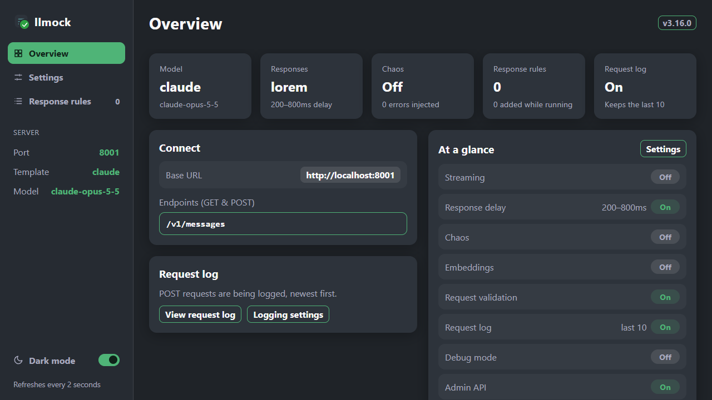

## Try it

```bash
npm create llmock@latest my-project
cd my-project
npm install
npm run llmock:start
```

Then open `http://localhost:8001` for the dashboard. [Getting started](/guide/getting-started) walks you through your first request.



::: tip Using a coding agent?
Point it at [`llms.txt`](/llms.txt) (also shipped in the npm package at `node_modules/llmock/llms.txt`): a compact reference to the CLI, config schema, response shapes and gotchas.
:::
